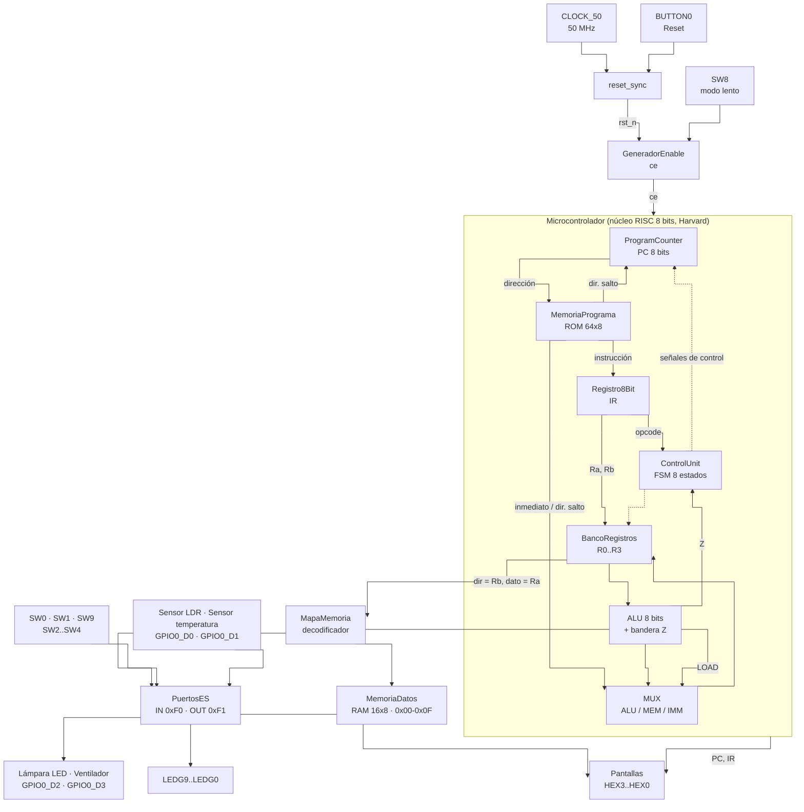
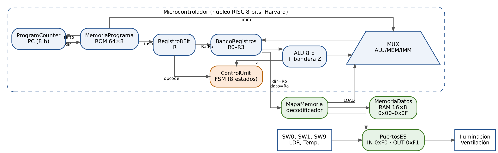
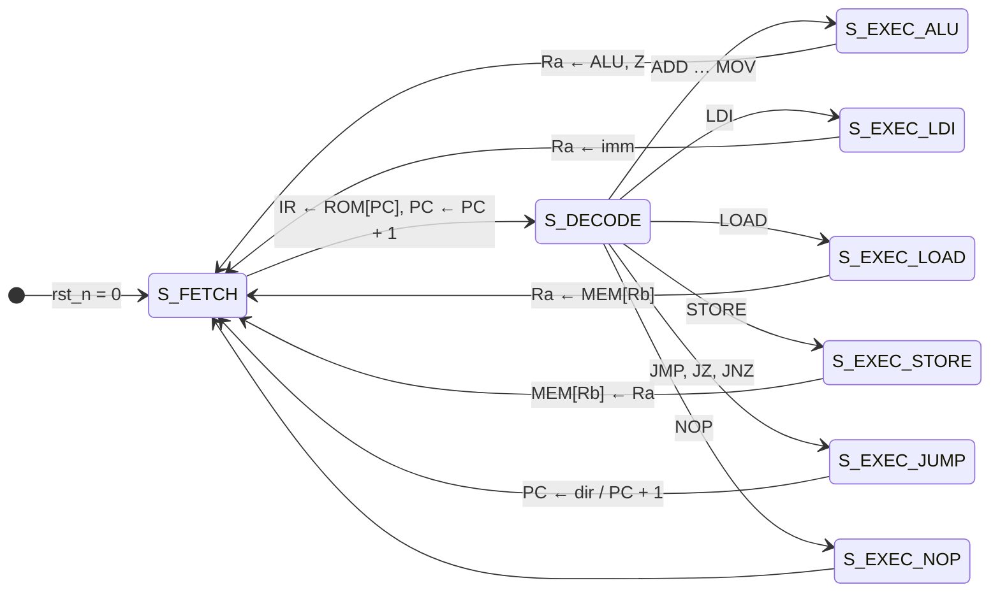
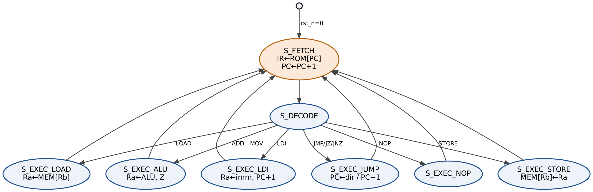
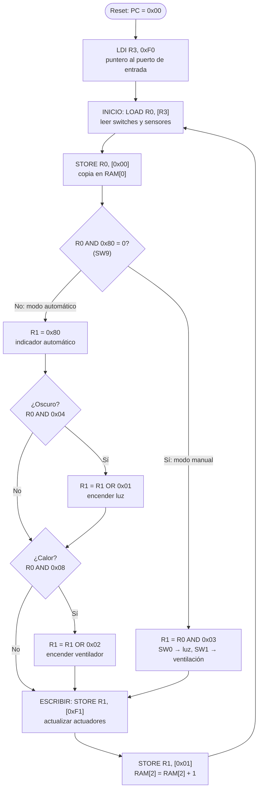
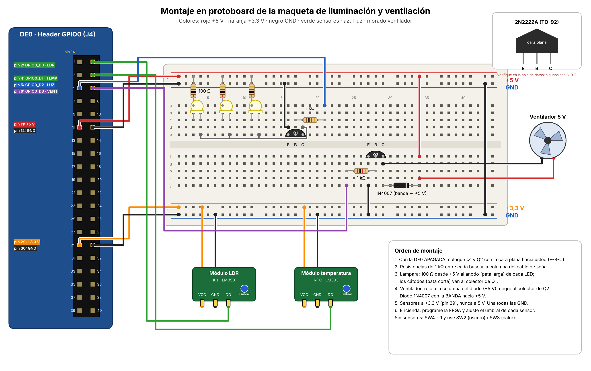
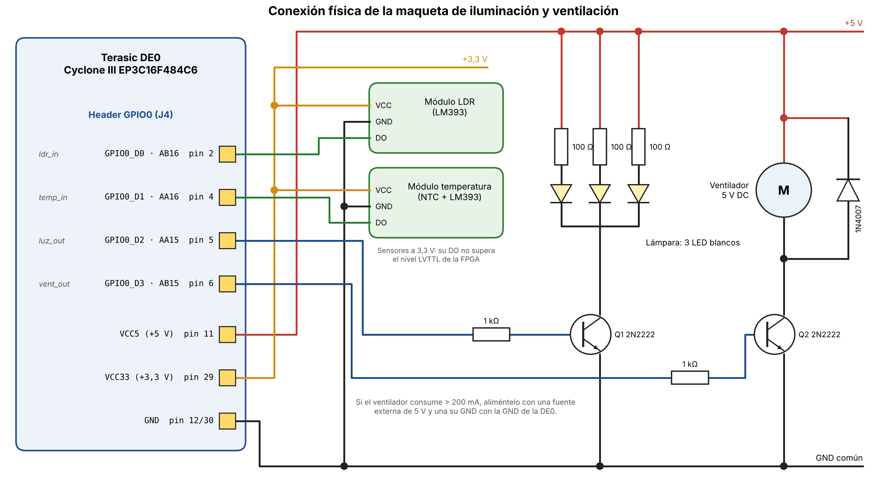

# Microcontrolador RISC de 8 bits con Control de Iluminación y Ventilación en VHDL

**Universidad del Cauca**  
**Autor:** Esteban Meneses - Santiago Cordoba

**Fecha:** Noviembre 2026  
**Proyecto Final**

---

## Descripción

Este proyecto implementa en VHDL un **microcontrolador RISC de 8 bits con arquitectura Harvard** y lo usa para controlar la **iluminación** y la **ventilación** de una maqueta. El microcontrolador ejecuta un programa guardado en una **memoria ROM** siguiendo el ciclo **FETCH → DECODE → EXECUTE**, que coordina una **máquina de estados finitos (FSM)**. Tiene contador de programa, registro de instrucción, banco de 4 registros, ALU con bandera Zero y una **memoria RAM** de datos.

Los switches, los sensores y los actuadores se acceden como **direcciones de memoria** (E/S mapeada en memoria): el programa lee el puerto `0xF0` y escribe el puerto `0xF1` con las mismas instrucciones `LOAD` y `STORE` que usa la RAM.

El sistema tiene dos modos de funcionamiento:

- **Modo manual** (`SW9 = 0`): `SW0` enciende la iluminación y `SW1` la ventilación.
- **Modo automático** (`SW9 = 1`): el programa enciende la iluminación cuando el sensor de luz detecta oscuridad y la ventilación cuando el sensor de temperatura detecta calor.

Todo el diseño usa un único reloj de 50 MHz, no genera latches y está verificado con cuatro testbenches autoverificables.

---

# Cumplimiento del enunciado

| Requisito | Cómo se cumple en este proyecto |
|-----------|----------------------------------|
| Arquitectura Harvard | La ROM de programa ([`MemoriaPrograma.vhd`](rtl/MemoriaPrograma.vhd)) tiene su propio bus, direccionado por el PC. La memoria de datos y la E/S usan un bus independiente ([`MapaMemoria.vhd`](rtl/MapaMemoria.vhd)). |
| Ancho de palabra mínimo de 8 bits | Datos, instrucciones, registros y direcciones de 8 bits (`DATA_WIDTH = 8` en [`pkg_mcu.vhd`](rtl/pkg_mcu.vhd)). |
| Ciclo FETCH → DECODE → EXECUTE | [`ControlUnit.vhd`](rtl/ControlUnit.vhd): estados `S_FETCH`, `S_DECODE` y seis estados de ejecución. |
| Program Counter (PC) | [`ProgramCounter.vhd`](rtl/ProgramCounter.vhd): incremento, carga para saltos y reset. |
| Instruction Register (IR) | [`Registro8Bit.vhd`](rtl/Registro8Bit.vhd): retiene la instrucción durante DECODE y EXECUTE. |
| Banco de registros (mínimo 4) | [`BancoRegistros.vhd`](rtl/BancoRegistros.vhd): R0–R3, dos lecturas combinacionales y una escritura síncrona. |
| ALU con operaciones aritméticas y lógicas | [`ALU.vhd`](rtl/ALU.vhd): ADD, SUB, AND, OR, XOR, NOT, INC, DEC, PASS_B y bandera Z. |
| Memoria ROM (programa) | ROM de 64×8 generada desde [`asm/programa.asm`](asm/programa.asm) con [`asm/ensamblador.py`](asm/ensamblador.py). |
| Memoria RAM | [`MemoriaDatos.vhd`](rtl/MemoriaDatos.vhd): RAM de 16×8 (direcciones `0x00`–`0x0F`). |
| Unidad de control con FSM | FSM Moore de 8 estados escrita en dos procesos (sin latches). |
| Mínimo 3 entradas: switch de iluminación, de ventilación y de modo | `SW0`, `SW1` y `SW9`, leídos en el puerto `0xF0` ([`PuertosES.vhd`](rtl/PuertosES.vhd)). |
| Mínimo 2 salidas digitales: iluminación y ventilación | `luz_out` (GPIO0_D2) y `vent_out` (GPIO0_D3), escritas en el puerto `0xF1`. |
| E/S mediante direcciones de memoria | `0xF0` = puerto de entrada, `0xF1` = puerto de salida ([mapa de memoria](#mapa-de-memoria)). |
| Modo manual y modo automático | Programa de control en ensamblador ([ver sección](#programa-de-control)). |
| Maqueta física | Sensores LDR y de temperatura, lámpara de LED y ventilador de 5 V ([ver conexión](#conexión-física-de-la-maqueta)). |
| A. Código completo | Carpeta [`rtl/`](rtl/) + proyecto de Quartus (`top_system.qpf/.qsf/.sdc`). |
| B. Testbench | Carpeta [`sim/`](sim/): 4 testbenches autoverificables (140 comprobaciones). |
| C. Funcionalidad | Pruebas T1–T7 del sistema completo y prueba en la tarjeta DE0. |
| D. Informe corto (máx. 3 páginas) | [`docs/informe/`](docs/informe/): informe en formato IEEE. |

---

# Características del sistema

- Núcleo RISC de 8 bits con arquitectura Harvard y 16 instrucciones.
- Formato de instrucción `[OpCode(4) | Ra(2) | Rb(2)]`; `LDI`, `JMP`, `JZ` y `JNZ` usan una segunda palabra.
- FSM Moore de 8 estados: cada instrucción tarda 3 ciclos de reloj.
- ROM de programa de 64×8 y RAM de datos de 16×8.
- E/S mapeada en memoria con entradas sincronizadas por 2 flip-flops.
- Ensamblador propio de dos pasadas que genera la ROM en VHDL.
- Modo manual y modo automático (sensores de luz y temperatura).
- Sensores simulables con `SW2`/`SW3` para probar sin la maqueta (`SW4 = 1`).
- **Modo lento** (`SW8 = 1`): la CPU avanza 4 pasos por segundo para ver el programa en los displays.
- Displays HEX3..HEX0 con PC e IR, o con los puertos de entrada y salida (`SW7`).
- LEDs con el estado de la FSM, los sensores, los actuadores y el modo.
- Un solo reloj de 50 MHz con habilitación de reloj (`ce`), sin relojes derivados.
- Compatible con Quartus II 13.1, ModelSim-Altera y GHDL.
- Implementado para la FPGA Cyclone III de la tarjeta DE0 (EP3C16F484C6).

---

# Jerarquía del diseño

```text
Cyclone III: EP3C16F484C6
└── top_system ................................ rtl/top_system.vhd
    ├── reset_sync:u_rst ...................... rtl/reset_sync.vhd
    ├── GeneradorEnable:u_ce .................. rtl/GeneradorEnable.vhd
    ├── Microcontrolador:u_mcu ................ rtl/Microcontrolador.vhd
    │   ├── ProgramCounter:u_pc ............... rtl/ProgramCounter.vhd
    │   ├── MemoriaPrograma:u_rom ............. rtl/MemoriaPrograma.vhd
    │   ├── Registro8Bit:u_ir ................. rtl/Registro8Bit.vhd
    │   ├── ControlUnit:u_cu .................. rtl/ControlUnit.vhd
    │   ├── BancoRegistros:u_regs ............. rtl/BancoRegistros.vhd
    │   └── ALU:u_alu ......................... rtl/ALU.vhd
    ├── MapaMemoria:u_map ..................... rtl/MapaMemoria.vhd
    ├── MemoriaDatos:u_ram .................... rtl/MemoriaDatos.vhd
    ├── PuertosES:u_io ........................ rtl/PuertosES.vhd
    └── Pantallas:u_disp ...................... rtl/Pantallas.vhd

pkg_mcu (paquete usado por todos) ............. rtl/pkg_mcu.vhd
```

| Instancia | Entidad | Archivo |
|---|---|---|
| — | `top_system` | [rtl/top_system.vhd](rtl/top_system.vhd) |
| `u_rst` | `reset_sync` | [rtl/reset_sync.vhd](rtl/reset_sync.vhd) |
| `u_ce` | `GeneradorEnable` | [rtl/GeneradorEnable.vhd](rtl/GeneradorEnable.vhd) |
| `u_mcu` | `Microcontrolador` | [rtl/Microcontrolador.vhd](rtl/Microcontrolador.vhd) |
| `u_mcu/u_pc` | `ProgramCounter` | [rtl/ProgramCounter.vhd](rtl/ProgramCounter.vhd) |
| `u_mcu/u_rom` | `MemoriaPrograma` | [rtl/MemoriaPrograma.vhd](rtl/MemoriaPrograma.vhd) |
| `u_mcu/u_ir` | `Registro8Bit` | [rtl/Registro8Bit.vhd](rtl/Registro8Bit.vhd) |
| `u_mcu/u_cu` | `ControlUnit` | [rtl/ControlUnit.vhd](rtl/ControlUnit.vhd) |
| `u_mcu/u_regs` | `BancoRegistros` | [rtl/BancoRegistros.vhd](rtl/BancoRegistros.vhd) |
| `u_mcu/u_alu` | `ALU` | [rtl/ALU.vhd](rtl/ALU.vhd) |
| `u_map` | `MapaMemoria` | [rtl/MapaMemoria.vhd](rtl/MapaMemoria.vhd) |
| `u_ram` | `MemoriaDatos` | [rtl/MemoriaDatos.vhd](rtl/MemoriaDatos.vhd) |
| `u_io` | `PuertosES` | [rtl/PuertosES.vhd](rtl/PuertosES.vhd) |
| `u_disp` | `Pantallas` | [rtl/Pantallas.vhd](rtl/Pantallas.vhd) |
| (paquete) | `pkg_mcu` | [rtl/pkg_mcu.vhd](rtl/pkg_mcu.vhd) |

---

# Arquitectura del sistema



<details>
<summary>Diagrama de bloques detallado</summary>



</details>

---

# Conjunto de instrucciones (ISA)

Formato de las instrucciones de 1 palabra:

```text
  7   6   5   4   3   2   1   0
+---------------+-------+-------+
|    OpCode     |  Ra   |  Rb   |
+---------------+-------+-------+
```

`LDI`, `JMP`, `JZ` y `JNZ` ocupan **2 palabras**: la segunda es el dato inmediato o la dirección de salto, y se toma de la ROM en el propio estado de ejecución.

| OpCode | Instrucción | Operación | Palabras | Bandera Z |
|:---:|---|---|:---:|:---:|
| `0000` | `NOP` | Sin operación | 1 | — |
| `0001` | `ADD Ra, Rb` | Ra ← Ra + Rb | 1 | ✔ |
| `0010` | `SUB Ra, Rb` | Ra ← Ra − Rb | 1 | ✔ |
| `0011` | `AND Ra, Rb` | Ra ← Ra AND Rb | 1 | ✔ |
| `0100` | `OR Ra, Rb` | Ra ← Ra OR Rb | 1 | ✔ |
| `0101` | `XOR Ra, Rb` | Ra ← Ra XOR Rb | 1 | ✔ |
| `0110` | `NOT Ra` | Ra ← NOT Ra | 1 | ✔ |
| `0111` | `INC Ra` | Ra ← Ra + 1 | 1 | ✔ |
| `1000` | `DEC Ra` | Ra ← Ra − 1 | 1 | ✔ |
| `1001` | `MOV Ra, Rb` | Ra ← Rb | 1 | ✔ |
| `1010` | `LDI Ra, #k` | Ra ← k | 2 | — |
| `1011` | `LOAD Ra, [Rb]` | Ra ← MEM[Rb] | 1 | — |
| `1100` | `STORE Ra, [Rb]` | MEM[Rb] ← Ra | 1 | — |
| `1101` | `JMP d` | PC ← d | 2 | — |
| `1110` | `JZ d` | Si Z = 1, PC ← d | 2 | — |
| `1111` | `JNZ d` | Si Z = 0, PC ← d | 2 | — |

---

# Mapa de memoria

| Dirección | Recurso | Acceso | Uso en el programa |
|---|---|---|---|
| `0x00` | RAM[0] | L/E | Copia del puerto de entrada |
| `0x01` | RAM[1] | L/E | Última salida escrita |
| `0x02` | RAM[2] | L/E | Contador de iteraciones del lazo principal |
| `0x03`–`0x0F` | RAM[3..15] | L/E | Libre |
| `0xF0` | Puerto de **entrada** | L | Switches y sensores |
| `0xF1` | Puerto de **salida** | L/E | Actuadores |

**Puerto de entrada (`0xF0`)**

| Bit | 7 | 6..4 | 3 | 2 | 1 | 0 |
|---|---|---|---|---|---|---|
| Señal | `SW9` modo | 0 | calor | oscuro | `SW1` ventilación | `SW0` luz |

**Puerto de salida (`0xF1`)**

| Bit | 7 | 6..2 | 1 | 0 |
|---|---|---|---|---|
| Señal | indicador automático (`LEDG9`) | 0 | ventilación (`vent_out`) | iluminación (`luz_out`) |

---

# Máquina de Estados (FSM)

La unidad de control ([`ControlUnit.vhd`](rtl/ControlUnit.vhd)) es una FSM tipo Moore escrita en dos procesos: uno síncrono con el registro de estado y otro combinacional con valores por defecto para todas las salidas, por lo que no se infieren latches.

## Estados implementados

| Estado | Código (LEDG6..4) | Señales activas | Función |
|---|---|---|---|
| `S_FETCH` | 0 | `ir_load`, `pc_inc` | IR ← ROM[PC], PC ← PC + 1 |
| `S_DECODE` | 1 | — | Elige el estado de ejecución según el OpCode |
| `S_EXEC_ALU` | 2 | `reg_we`, `flag_we`, `alu_sel` | Ra ← ALU(Ra, Rb) y actualiza Z |
| `S_EXEC_LDI` | 3 | `reg_we`, `reg_src = IMM`, `pc_inc` | Ra ← ROM[PC] (inmediato) |
| `S_EXEC_LOAD` | 4 | `reg_we`, `reg_src = MEM` | Ra ← MEM[Rb] (RAM o puerto de entrada) |
| `S_EXEC_STORE` | 5 | `mem_we` | MEM[Rb] ← Ra (RAM o puerto de salida) |
| `S_EXEC_JUMP` | 6 | `pc_load` o `pc_inc` | Salta si se cumple la condición; si no, omite la dirección |
| `S_EXEC_NOP` | 7 | — | No hace nada |

## Diagrama FSM



<details>
<summary>Diagrama de estados en imagen</summary>



</details>

---

# Programa de control

El programa está en [`asm/programa.asm`](asm/programa.asm). El ensamblador [`asm/ensamblador.py`](asm/ensamblador.py) lo traduce y genera directamente [`rtl/MemoriaPrograma.vhd`](rtl/MemoriaPrograma.vhd):

```bash
python asm/ensamblador.py asm/programa.asm rtl/MemoriaPrograma.vhd
```

## Diagrama de flujo del programa



| Modo | `SW9` | Iluminación | Ventilación | `LEDG9` |
|---|:---:|---|---|:---:|
| Manual | 0 | `SW0` | `SW1` | 0 |
| Automático | 1 | Sensor de luz detecta **oscuridad** | Sensor de temperatura detecta **calor** | 1 |

Una iteración del lazo dura **54 ciclos** en modo manual y **84 ciclos** en modo automático (1,1 µs y 1,7 µs a 50 MHz), así que el sistema reacciona a un cambio en menos de 2 µs.

## Contenido de la ROM (generado)

| Dir. | Hex | Instrucción | | Dir. | Hex | Instrucción |
|---|---|---|---|---|---|---|
| `00` | `AC F0` | `LDI R3, 0xF0` | | `1A` | `A8 02` | `LDI R2, 0x02` |
| `02` | `B3` | `INICIO: LOAD R0, [R3]` | | `1C` | `46` | `OR R1, R2` |
| `03` | `A8 00` | `LDI R2, 0x00` | | `1D` | `D0 22` | `JMP ESCRIBIR` |
| `05` | `C2` | `STORE R0, [R2]` | | `1F` | `A4 03` | `MANUAL: LDI R1, 0x03` |
| `06` | `A4 80` | `LDI R1, 0x80` | | `21` | `34` | `AND R1, R0` |
| `08` | `34` | `AND R1, R0` | | `22` | `7C` | `ESCRIBIR: INC R3` |
| `09` | `E0 1F` | `JZ MANUAL` | | `23` | `C7` | `STORE R1, [R3]` |
| `0B` | `A4 80` | `AUTO: LDI R1, 0x80` | | `24` | `8C` | `DEC R3` |
| `0D` | `A8 04` | `LDI R2, 0x04` | | `25` | `A8 01` | `LDI R2, 0x01` |
| `0F` | `38` | `AND R2, R0` | | `27` | `C6` | `STORE R1, [R2]` |
| `10` | `E0 15` | `JZ REV_TEMP` | | `28` | `78` | `INC R2` |
| `12` | `A8 01` | `LDI R2, 0x01` | | `29` | `B2` | `LOAD R0, [R2]` |
| `14` | `46` | `OR R1, R2` | | `2A` | `70` | `INC R0` |
| `15` | `A8 08` | `REV_TEMP: LDI R2, 0x08` | | `2B` | `C2` | `STORE R0, [R2]` |
| `17` | `38` | `AND R2, R0` | | `2C` | `D0 02` | `JMP INICIO` |
| `18` | `E0 22` | `JZ ESCRIBIR` | | `2E`–`3F` | `00` | `NOP` |

---

# Funciones, constantes y tipos

## Constantes principales

```vhdl
CONSTANT DATA_WIDTH : INTEGER := 8;   -- Ancho de palabra
CONSTANT ROM_DEPTH  : INTEGER := 64;  -- Palabras de programa
CONSTANT RAM_DEPTH  : INTEGER := 16;  -- Palabras de datos

CONSTANT ADDR_IN_PORT  : word_t := x"F0";  -- Puerto de entrada
CONSTANT ADDR_OUT_PORT : word_t := x"F1";  -- Puerto de salida
```

## Tipos de memoria

```vhdl
SUBTYPE word_t IS STD_LOGIC_VECTOR(DATA_WIDTH - 1 DOWNTO 0);
TYPE rom_array_t IS ARRAY (0 TO ROM_DEPTH - 1) OF word_t;
TYPE ram_array_t IS ARRAY (0 TO RAM_DEPTH - 1) OF word_t;
```

## Función

```vhdl
FUNCTION hex_to_7seg(hex : STD_LOGIC_VECTOR(3 DOWNTO 0)) RETURN STD_LOGIC_VECTOR;
-- Convierte un dígito hexadecimal al código gfedcba (activo en bajo) de la DE0
```

---

# Conexión física de la maqueta

## Montaje en protoboard



## Esquemático



```text
              DE0 · Header GPIO0 (J4)
        ┌───────────────────────────────┐
        │ pin 2  GPIO0_D0 (AB16) ◄──────┼──── DO  Módulo LDR (LM393)
        │ pin 4  GPIO0_D1 (AA16) ◄──────┼──── DO  Módulo temperatura (NTC + LM393)
        │ pin 5  GPIO0_D2 (AA15) ───────┼──► 1 kΩ ──► base Q1 2N2222 ──► lámpara LED
        │ pin 6  GPIO0_D3 (AB15) ───────┼──► 1 kΩ ──► base Q2 2N2222 ──► ventilador 5 V
        │ pin 11 VCC5  (+5 V)   ────────┼──► ánodo LEDs (100 Ω c/u) y ventilador (+1N4007)
        │ pin 29 VCC33 (+3,3 V) ────────┼──► VCC de los dos módulos sensores
        │ pin 12/30 GND         ────────┼──► GND común (sensores, emisores Q1/Q2)
        └───────────────────────────────┘
```

## Lista de materiales

| Cant. | Componente | Uso |
|:---:|---|---|
| 1 | Tarjeta Terasic DE0 (Cyclone III) | Microcontrolador |
| 1 | Módulo sensor de luz LDR con LM393 (salida DO) | Detección de oscuridad |
| 1 | Módulo sensor de temperatura NTC con LM393 (salida DO, p. ej. KY-028) | Detección de calor |
| 3 | LED blancos de 5 mm + 3 resistencias de 100 Ω | Lámpara de la maqueta |
| 1 | Ventilador de 5 V DC (≤ 200 mA) | Ventilación |
| 2 | Transistores NPN 2N2222 | Etapas de potencia |
| 2 | Resistencias de 1 kΩ | Base de los transistores |
| 1 | Diodo 1N4007 | Rueda libre del ventilador |
| — | Protoboard, cables dupont, maqueta (cartón, MDF o acrílico) | Montaje |

## Notas de montaje

- Los módulos sensores se alimentan con **3,3 V** (pin 29) para que su salida DO no supere el nivel 3,3-V LVTTL de la FPGA.
- Si el ventilador consume más de 200 mA, aliméntelo con una fuente externa de 5 V y una su GND con la GND de la DE0.
- Ajuste el umbral de cada sensor con el potenciómetro del módulo LM393.
- Si un módulo entrega `'0'` en la condición activa, cambie el genérico `LDR_ACTIVO_ALTO` o `TEMP_ACTIVO_ALTO` a `FALSE` en [`top_system.vhd`](rtl/top_system.vhd).
- Para probar sin sensores, ponga `SW4 = 1`: `SW2` simula oscuridad y `SW3` simula calor.

---

# Asignación de pines (DE0)

| Señal | Pin | Recurso de la DE0 | Función |
|---|---|---|---|
| `clk` | PIN_G21 | CLOCK_50 | Reloj de 50 MHz |
| `rst_n` | PIN_H2 | BUTTON0 | Reset (activo en bajo) |
| `SW[0]` | PIN_J6 | SW0 | Iluminación (modo manual) |
| `SW[1]` | PIN_H5 | SW1 | Ventilación (modo manual) |
| `SW[2]` | PIN_H6 | SW2 | Oscuridad simulada |
| `SW[3]` | PIN_G4 | SW3 | Calor simulado |
| `SW[4]` | PIN_G5 | SW4 | Fuente de sensores (0 = GPIO, 1 = SW2/SW3) |
| `SW[7]` | PIN_E3 | SW7 | Vista de displays (0 = PC/IR, 1 = puertos) |
| `SW[8]` | PIN_E4 | SW8 | Modo lento (4 pasos/s) |
| `SW[9]` | PIN_D2 | SW9 | Modo (0 = manual, 1 = automático) |
| `ldr_in` | PIN_AB16 | GPIO0_D0 (J4 pin 2) | Sensor de luz |
| `temp_in` | PIN_AA16 | GPIO0_D1 (J4 pin 4) | Sensor de temperatura |
| `luz_out` | PIN_AA15 | GPIO0_D2 (J4 pin 5) | Actuador de iluminación |
| `vent_out` | PIN_AB15 | GPIO0_D3 (J4 pin 6) | Actuador de ventilación |
| `LEDG[0]` | PIN_J1 | LEDG0 | Iluminación encendida |
| `LEDG[1]` | PIN_J2 | LEDG1 | Ventilación encendida |
| `LEDG[2]` | PIN_J3 | LEDG2 | Sensor: oscuro |
| `LEDG[3]` | PIN_H1 | LEDG3 | Sensor: calor |
| `LEDG[6:4]` | PIN_C1, E1, F2 | LEDG6..4 | Estado de la FSM (0–7) |
| `LEDG[8]` | PIN_B2 | LEDG8 | Latido de la CPU (cambia en cada FETCH) |
| `LEDG[9]` | PIN_B1 | LEDG9 | Modo automático activo |
| `HEX3..HEX0` | ver `.qsf` | Displays | PC · IR, o entrada · salida |

---

# Estructura del repositorio

```text
Microcontrolador_RISC_8bits/
├── rtl/                        Código VHDL sintetizable
│   ├── pkg_mcu.vhd             Constantes, ISA, mapa de memoria, tipos
│   ├── reset_sync.vhd          Sincronizador de reset
│   ├── GeneradorEnable.vhd     Habilitación de reloj (modo lento)
│   ├── ProgramCounter.vhd      PC
│   ├── Registro8Bit.vhd        IR
│   ├── BancoRegistros.vhd      R0..R3
│   ├── ALU.vhd                 ALU de 8 bits
│   ├── MemoriaPrograma.vhd     ROM 64x8 (generada por el ensamblador)
│   ├── ControlUnit.vhd         FSM FETCH-DECODE-EXECUTE
│   ├── Microcontrolador.vhd    Núcleo (integra el datapath)
│   ├── MemoriaDatos.vhd        RAM 16x8
│   ├── PuertosES.vhd           Puertos de entrada/salida
│   ├── MapaMemoria.vhd         Decodificador de direcciones
│   ├── Pantallas.vhd           Displays de 7 segmentos
│   └── top_system.vhd          Nivel superior para la DE0
├── sim/                        Verificación
│   ├── tb_ALU.vhd
│   ├── tb_ControlUnit.vhd
│   ├── tb_Microcontrolador.vhd
│   ├── tb_top_system.vhd
│   ├── run_ghdl.sh             Simulación con GHDL
│   └── run_modelsim.do         Simulación con ModelSim
├── asm/
│   ├── programa.asm            Programa de control
│   └── ensamblador.py          Ensamblador -> MemoriaPrograma.vhd
├── docs/
│   ├── diagramas/              Bloques, FSM y conexión física
│   ├── simulacion/             Formas de onda
│   ├── informe/                Informe IEEE
│   └── Prompts_Asistentes_IA.docx
├── top_system.qpf              Proyecto de Quartus II 13.1
├── top_system.qsf              Dispositivo, archivos y pines
├── top_system.sdc              Restricciones de tiempo (50 MHz)
└── README.md
```

---

# Cómo compilar y simular

**Quartus II 13.1**

1. Abra `top_system.qpf`.
2. *Processing → Start Compilation*.
3. *Tools → Programmer*, seleccione `output_files/top_system.sof` y programe la DE0 por USB-Blaster.

**ModelSim-Altera** (desde la carpeta raíz del proyecto):

```tcl
do sim/run_modelsim.do
```

**GHDL**:

```bash
./sim/run_ghdl.sh
```

---

# Evidencia de simulación

## Simulación completa (pruebas T1 a T7)


## Detalle del ciclo FETCH → DECODE → EXECUTE

Con `SW0 = 1` en modo manual, el programa lee el puerto `0xF0` (`LOAD`), toma el salto `JZ` a `MANUAL` (PC `0A` → `1F`), calcula `AND` con `0x03` y escribe `01` en el puerto `0xF1` (`STORE`), lo que enciende `luz_out`:


## Resultado de la simulación

```text
===== tb_ALU =====
tb_ALU: 17/17 vectores PASAN
===== tb_ControlUnit =====
tb_ControlUnit: 18/18 secuencias FETCH-DECODE-EXECUTE PASAN
===== tb_Microcontrolador =====
Iteración en modo manual: 54 ciclos
Iteración en modo automático (luz+vent): 84 ciclos
tb_Microcontrolador: 98/98 comprobaciones PASAN
===== tb_top_system =====
T1 Reset inicial ... PASA
T2 Modo manual ... PASA
T3 Automático con sensores (GPIO) ... PASA
T4 Automático con sensores simulados (SW4) ... PASA
T5 Vista de puertos (SW7) ... PASA
T6 Modo lento (SW8) ... PASA
T7 Reset en funcionamiento ... PASA
tb_top_system: 7/7 pruebas PASAN, 0 errores
```

Para confirmar que los testbenches detectan errores reales se introdujeron dos fallos a propósito (condición de `JZ` invertida y decodificación errónea del puerto `0xF0`). En ambos casos las pruebas reportaron FALLA.

---

# Resultados de compilación (Quartus II 13.1)

| Parámetro | Resultado |
|---|---|
| Estado | **Successful: 0 errores** |
| Dispositivo | Cyclone III EP3C16F484C6 |
| Elementos lógicos | 461 / 15 408 (3 %) |
| Funciones combinacionales | 395 |
| Registros | 230 |
| Pines | 58 / 347 (17 %) |
| Bits de memoria | 0 (la RAM y la ROM, de lectura combinacional, se implementan en lógica) |
| Fmax (Slow 1200 mV 85 °C) | **92.89 MHz** (requerido: 50 MHz) |
| Slack de setup | +9.235 ns |
| Latches inferidos | Ninguno |

Las únicas advertencias son esperadas: `LEDG[7]` y los puntos decimales están fijos a GND/VCC y `SW[5]`/`SW[6]` no se usan.

---

# Archivos principales

| Archivo | Descripción |
|---|---|
| `pkg_mcu.vhd` | Paquete con constantes, códigos de operación, mapa de memoria, tipos y `hex_to_7seg` |
| `ProgramCounter.vhd` | Contador de programa con incremento y carga para saltos |
| `Registro8Bit.vhd` | Registro de instrucción (IR) |
| `BancoRegistros.vhd` | Banco de 4 registros con 2 puertos de lectura |
| `ALU.vhd` | ALU combinacional de 8 bits con bandera Zero |
| `MemoriaPrograma.vhd` | ROM de programa 64×8 generada por el ensamblador |
| `ControlUnit.vhd` | FSM Moore FETCH → DECODE → EXECUTE |
| `Microcontrolador.vhd` | Núcleo: interconecta el camino de datos y el de control |
| `MemoriaDatos.vhd` | RAM de datos 16×8 |
| `PuertosES.vhd` | Puertos de entrada (sincronizados) y de salida |
| `MapaMemoria.vhd` | Decodificador de direcciones del bus de datos |
| `Pantallas.vhd` | Displays de 7 segmentos |
| `GeneradorEnable.vhd` | Habilitación de reloj para el modo lento |
| `reset_sync.vhd` | Sincronización del pulsador de reset |
| `top_system.vhd` | Integración estructural y pines de la tarjeta |
| `tb_*.vhd` | Testbenches autoverificables |
| `programa.asm` / `ensamblador.py` | Programa de control y su ensamblador |

---

# Señales principales

| Señal | Función |
|---|---|
| `clk` | Reloj del sistema de 50 MHz (CLOCK_50) |
| `rst_n` / `rst_n_int` | Reset: pulsador activo en bajo / reset interno sincronizado |
| `ce` | Habilitación de reloj de la CPU (`'1'` a velocidad normal, pulsos en modo lento) |
| `pc_value` | Dirección actual de la ROM |
| `rom_data` | Instrucción o dato inmediato leído de la ROM |
| `ir_value` | Instrucción en ejecución |
| `current_state` | Estado de la FSM |
| `reg_a` / `reg_b` | Registros Ra y Rb seleccionados por el IR |
| `alu_result` / `z_flag` | Resultado de la ALU / bandera Zero registrada |
| `mem_addr` / `mem_wdata` / `mem_we` | Bus de datos: dirección (Rb), dato (Ra) y escritura |
| `mem_rdata` | Dato leído de la RAM o de un puerto |
| `in_port` / `out_port` | Puerto de entrada `0xF0` / puerto de salida `0xF1` |
| `luz_out` / `vent_out` | Actuadores físicos |

---

# Validaciones realizadas

- **ALU**: las 9 operaciones, desbordamientos y bandera Zero (17 vectores).
- **Unidad de control**: secuencia FETCH → DECODE → EXECUTE de los 16 OpCodes y saltos condicionales con Z = 0 y Z = 1.
- **Núcleo**: programa real contra un modelo de memoria independiente; las 32 combinaciones de modo, switches y sensores; contenido de RAM[0], RAM[1] y RAM[2].
- **Sistema completo**: reset, modo manual, modo automático con sensores GPIO y simulados, displays, modo lento y reset en funcionamiento.
- **Prueba de los testbenches**: fallos inyectados a propósito detectados.

---

# Herramientas utilizadas

- Quartus II 13.1 Web Edition
- ModelSim-Altera
- GHDL 4.1
- Python 3 (ensamblador)
- Tarjeta Terasic DE0 (Cyclone III EP3C16F484C6)
- VHDL-93 (IEEE.STD_LOGIC_1164, IEEE.NUMERIC_STD)

---

# Resultado final

- ✔ Microcontrolador RISC de 8 bits con arquitectura Harvard
- ✔ Ciclo FETCH → DECODE → EXECUTE con FSM de 8 estados
- ✔ PC, IR, banco de 4 registros, ALU, ROM y RAM
- ✔ E/S mapeada en memoria (`0xF0` / `0xF1`)
- ✔ Modo manual y modo automático
- ✔ Maqueta con sensores de luz y temperatura, lámpara y ventilador
- ✔ 4 testbenches autoverificables (140 comprobaciones, 0 errores)
- ✔ Informe en formato IEEE

---

# Autor

**Esteban Meneses**  
Ingeniería Electrónica y Telecomunicaciones  
Universidad del Cauca
